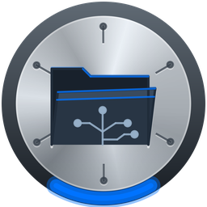

<p align="center">
  
</p>

# RooTree

A **file manager for Sailfish OS**, built on **Qt 6.12** with a core written in
**Rust** and a UI written from scratch in QML — not a fork of an existing file
manager. Part of the `RooT*` app family.

> [!WARNING]
> **🇬🇧 RooTree is BETA software.** It may misbehave and it **may cause loss of
> data and files** — on the phone, on memory cards and on remote or cloud
> storage. Keep backups of anything that matters. **You use it entirely at your
> own risk.**
>
> **🇮🇹 RooTree è un'app in versione BETA.** Può dare problemi e **può causare la
> perdita di dati e file**, sul telefono, sulle schede di memoria e sugli spazi
> remoti o cloud. Tieni una copia di tutto ciò che è importante. **L'uso è a tuo
> esclusivo rischio.**

---

## [ENGLISH]

Prerequisite: Sailfish OS 5.1 or later · **aarch64** (armv7hl packages are built but not yet tested on a real device)  
Telegram Group: https://t.me/+E7V-a7x4JbY1Njhk  
RooTree is tested on:  
- POCO M4 Pro 4G (Sailfish OS 5.2.0.22, community port)  
- Sony Xperia 10 III (Sailfish OS 5.2.0.22): clean install  

This application was developed using artificial intelligence technologies, specifically Claude Code Opus. Therefore, if the use of an application generated via a large-scale language model (LLM) is not comfortable for the user, it is recommended to avoid its installation and use. It is specified that any negative comment regarding this circumstance will not only be ignored but will result in the immediate blocking of the user.

I hereby disclaim any and all responsibility for the application, its functionality, and any consequences arising from its use. By choosing to use this application, the user acknowledges and accepts that they do so entirely at their own risk, and agrees that the developer shall not be held liable for any damages, losses, or adverse effects—whether direct, indirect, incidental, or consequential—resulting from the use or misuse of the application, **including the loss of data and files**.

### What it does

- **Local storage**: internal memory, Android storage, SD card and USB drives,
  with their standard folders one tap away; USB drives that Sailfish OS leaves
  unmounted are mounted with a tap, and ⏏ ejects a card or a drive safely
  (pending writes, unmount, power off); bookmarks, breadcrumbs,
  back/forward/up, icon and detail views, sorting, hidden files.
- **File operations** in a queue, with progress and **Cancel**: copy, move,
  delete, rename, new folder, permissions. Conflicts and errors are asked
  about, never silently overwritten; copies go through a temporary file.
- **Trash** for local and remote deletions.
- **Previews**: images (also WebP, TIFF, BMP), videos and PDFs; an image viewer
  with swipe and pinch-zoom, and a **text editor**.
- **Archives**: create and extract ZIP, TAR (gz, bz2, xz, zst) and 7z, browse
  an archive like a folder; RAR, ISO and cpio are extracted through the
  system's `bsdtar`.
- **Search** by name, regular expression or file content.
- **Remote and cloud storage**: SFTP, FTP/FTPS, WebDAV/Nextcloud, SMB, S3,
  Dropbox, Mega and kDrive (Infomaniak), with the same operations as local
  folders.
- **Synchronisation** between a local and a remote folder (two-way, local to
  remote, or remote to local), set up with a guided wizard.
- **Open with** any Sailfish app, and **Share** through the system dialog.
- **Root mode**: unlocked with the developer-mode password. A small helper
  does the file operations as root; the app itself never runs as root.
  Without developer mode, RooTree works normally and just tells you that root
  mode needs it.
- Two looks: the frozen **RooTundra** theme (default) or a plain
  **Sailfish OS** theme that follows your ambience.
- Interface in **English** and **Italian**.

### Install

RooTree is **one package**, complete in itself: Qt 6.12 is inside. Copy the RPM
for your phone (`aarch64` = 64-bit, `armv7hl` = 32-bit) to the phone and install it:

```sh
devel-su pkcon install-local harbour-rootree-<version>.aarch64.rpm
```

**Updating:** the same command with the new RPM. Up to 0.9.6 RooTree also needed
the separate `rootgpt-qt6-runtime` package (and up to 0.9.5 `harbour-rootree-root`):
updating to 0.9.7 or later removes them by itself.

RooTree and its Qt 6.12 are installed under `/home/rootree` (the `/home` partition,
because the phones' root file system is small; only the launcher, the root helper
and the icon stay there), apart from the system,
so it does not interfere with the platform. RooTree's `.desktop` declares
`Sandboxing=Disabled`: a file manager needs to reach every folder.

### Building from source

The build runs inside the Sailfish SDK build engine (`sfdk`), with targets
cloned from `SailfishOS-5.1.0.11-<arch>` that carry Qt 6.12
(`SailfishOS-5.1.0.11-<arch>-qt612`), and a Rust toolchain set up by
`tools/env-rust.sh`:

```sh
sfdk engine exec -- tools/build.sh aarch64       # Rust core + Qt app
sfdk engine exec -- tools/pacchetto.sh aarch64   # RPMs into RPMS/
```

The Rust core has its own tests: `cargo test` in `rust/`.

### License

RooTree is free software under the **GNU General Public License v3.0 or later**
(see [LICENSE](LICENSE)). Third-party components — Rust crates, the bundled
libssh2 and zstd, Font Awesome icons, the Rajdhani font, Qt 6 — and their
licenses are listed in [NOTICE.md](NOTICE.md).

---

## [ITALIANO]

Requisiti: Sailfish OS 5.1 o successivo · **aarch64** (i pacchetti armv7hl sono costruiti ma non ancora provati su un telefono vero)  
Gruppo Telegram: https://t.me/+E7V-a7x4JbY1Njhk  
RooTree è testato:  
- POCO M4 Pro 4G (Sailfish OS 5.2.0.22, port della comunità)  
- Sony Xperia 10 III (Sailfish OS 5.2.0.22): installazione pulita  

Questa applicazione è stata sviluppata utilizzando tecnologie di intelligenza artificiale, in particolare Claude Code Opus. Pertanto, se l'uso di un'applicazione generata tramite un modello linguistico su larga scala (LLM) non fosse per l'utente confortevole, si raccomanda di evitarne l'installazione e l'uso. Si specifica che qualsiasi commento negativo riguardante questa circostanza non verrà solo ignorato, ma comporterà il blocco immediato dell'utente.

Con la presente declino ogni responsabilità relativa all'applicazione, al suo funzionamento e a qualsiasi conseguenza derivante dal suo utilizzo. L'utente, scegliendo di utilizzare l'applicazione, riconosce e accetta di farlo a proprio ed esclusivo rischio, e concorda che lo sviluppatore non potrà essere ritenuto responsabile per eventuali danni, perdite o effetti negativi — diretti, indiretti, incidentali o consequenziali — derivanti dall'uso o dall'uso improprio dell'applicazione, **compresa la perdita di dati e file**.

### Cosa fa

- **Memorie locali**: memoria interna, memoria Android, scheda SD e chiavette
  USB, con le loro cartelle predefinite a portata di tocco; le chiavette che
  Sailfish OS lascia smontate si montano con un tocco, e ⏏ espelle in sicurezza
  una scheda o una chiavetta (scritture in sospeso, smonta, spegne); segnalibri,
  briciole, indietro/avanti/su, vista a icone o dettagli, ordinamento, file
  nascosti.
- **Operazioni sui file** in coda, con avanzamento e **Annulla**: copia,
  sposta, elimina, rinomina, nuova cartella, permessi. Conflitti ed errori
  vengono chiesti, mai sovrascritti in silenzio; le copie passano da un file
  temporaneo.
- **Cestino** per quello che si elimina, in locale e in remoto.
- **Anteprime**: immagini (anche WebP, TIFF, BMP), video e PDF; visore delle
  immagini con scorrimento e zoom a due dita, ed **editor di testo**.
- **Archivi**: crea ed estrai ZIP, TAR (gz, bz2, xz, zst) e 7z, sfoglia un
  archivio come una cartella; RAR, ISO e cpio si estraggono con il `bsdtar`
  di sistema.
- **Ricerca** per nome, espressione regolare o contenuto dei file.
- **Spazi remoti e cloud**: SFTP, FTP/FTPS, WebDAV/Nextcloud, SMB, S3, Dropbox,
  Mega e kDrive (Infomaniak), con le stesse operazioni delle cartelle locali.
- **Sincronizzazione** fra una cartella locale e una remota (nei due sensi,
  da locale a remoto o da remoto a locale), impostata con una procedura
  guidata.
- **Apri con** qualunque app di Sailfish, e **Condividi** con il dialogo di
  sistema.
- **Modalità root**: si apre con la password della modalità sviluppatore. Un
  piccolo aiutante fa le operazioni come root; l'app non gira mai come root.
  Senza modalità sviluppatore RooTree funziona normalmente e dice solo che la
  modalità root ne ha bisogno.
- Due aspetti: il tema ghiacciato **RooTundra** (predefinito) o un tema
  **Sailfish OS** semplice che segue la tua ambience.
- Interfaccia in **italiano** e **inglese**.

### Installazione

RooTree è **un pacchetto solo**, completo in sé: Qt 6.12 è dentro. Copia sul
telefono l'RPM giusto (`aarch64` = 64 bit, `armv7hl` = 32 bit) e installalo:

```sh
devel-su pkcon install-local harbour-rootree-<versione>.aarch64.rpm
```

**Aggiornare:** lo stesso comando con il nuovo RPM. Fino alla 0.9.6 serviva anche
il pacchetto a parte `rootgpt-qt6-runtime` (e fino alla 0.9.5 `harbour-rootree-root`):
aggiornando alla 0.9.7 o successiva si tolgono da soli.

RooTree e il suo Qt 6.12 si installano in `/home/rootree` (la partizione `/home`,
perché il file system di sistema dei telefoni è piccolo; lì restano solo l'avvio,
l'helper root e l'icona), separato dal sistema, così
non interferisce con la piattaforma. Il `.desktop` di RooTree dichiara
`Sandboxing=Disabled`: un file manager deve poter raggiungere ogni cartella.

### Compilare dai sorgenti

La build gira dentro il build engine dell'SDK di Sailfish (`sfdk`), con target
clonati da `SailfishOS-5.1.0.11-<arch>` che contengono Qt 6.12
(`SailfishOS-5.1.0.11-<arch>-qt612`), e con la toolchain Rust preparata da
`tools/env-rust.sh`:

```sh
sfdk engine exec -- tools/build.sh aarch64       # nucleo Rust + app Qt
sfdk engine exec -- tools/pacchetto.sh aarch64   # RPM in RPMS/
```

Il nucleo Rust ha i suoi test: `cargo test` in `rust/`.

### Licenza

RooTree è software libero sotto la **GNU General Public License v3.0 o
successiva** (vedi [LICENSE](LICENSE)). I componenti di terze parti — crate
Rust, libssh2 e zstd incluse, icone Font Awesome, font Rajdhani, Qt 6 — e le
loro licenze sono elencati in [NOTICE.md](NOTICE.md).
